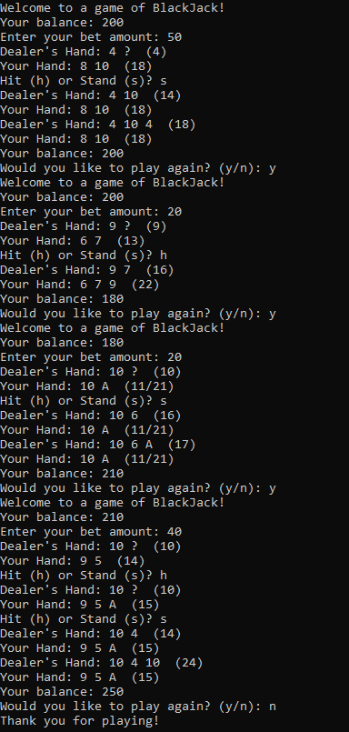
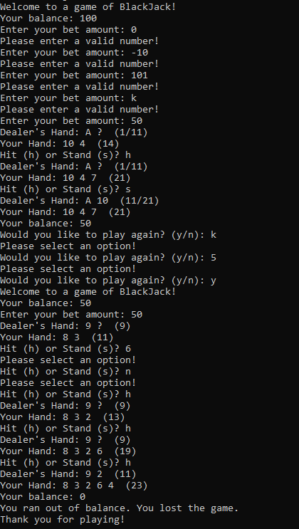

# x86Assembly-Blackjack (NASM)

A fully functional Blackjack game written in bare-metal x86 Assembly (NASM) for 32-bit Linux — no libraries, no runtime, just syscalls.

## Screenshots

<table align="center"><tr>
<td align="center" valign="middle"></td>
<td align="center" valign="middle"></td>
</tr></table>

---

## Features

- **Complete Blackjack rules** — Hit, Stand, Natural Blackjack (3:2 payout), Six-Card Charlie, Push
- **Ace soft/hard handling** — displayed as `(1/11)` during play, automatically resolved on bust
- **Dealer rules** — draws below 17 and stands on every 17, soft 17 included
- **Bet validation** — rejects invalid input, zero bets, and bets exceeding current balance with overflow protection
- **Balance tracking** — starts at $100, persists across rounds until game over
- **Replay loop** — ask to play again after each round; exits cleanly when balance hits $0
- **Line-based input** — an over-long answer is read as one answer and the rest of the line is dropped, and end of input quits the game
- **Zero dependencies** — no libc, no external libraries; linked directly as a static ELF32 binary

---

## How to Build

```bash
nasm -f elf32 blackjack.asm -o blackjack.o
ld -m elf_i386 blackjack.o -o blackjack
```

Requires `nasm` and GNU `ld`. Tested on x86 and x86_64 Linux (via 32-bit syscall ABI).

---

## How to Play

```bash
./blackjack
```

| Input | Action         |
|-------|----------------|
| `h`   | Hit            |
| `s`   | Stand          |
| `y`   | Play again     |
| `n`   | Quit           |

Uppercase inputs (`H`, `S`, `Y`, `N`) are accepted as well.

---

## Game Rules

- **Natural Blackjack** — 21 with exactly 2 cards pays **3:2**
- **Six-Card Charlie** — six cards without busting ends your turn and wins, unless the dealer has a natural or six cards as well (then the scores decide)
- **Push** — tie goes to neither player; bet is returned
- **Dealer Natural** — beats all non-natural player hands regardless of score. The hole card stays hidden until you finish your turn, so you only find out when the dealer reveals it
- **Player Natural** — settled right after the deal, pays 3:2, or is a push if the dealer has one too
- Dealer must draw below 17, stand on 17 and above

---

## Technical Notes

Written entirely in x86 NASM assembly targeting the Linux i386 syscall ABI (`int 0x80`).

- **Buffered output** — each screen update is collected in a buffer and written with one `sys_write`
- **Register discipline** — functions save only the registers they change, string lengths are assembler constants
- **Integer arithmetic only** — 3:2 natural payout computed as `bet + bet/2`, which equals `floor(3*bet/2)` without overflowing
- **Overflow-safe bet parsing** — input validated digit-by-digit against `money / 10` and `money % 10` to prevent integer overflow without any 64-bit arithmetic
- **Card draw** — `rdtsc` seeds a linear congruential generator once per game, and an already drawn card is replaced by the next free one, so every draw finishes within 52 steps
- **Ace adjustment loop** — `calculate_score` reduces aces from 11 to 1 iteratively until score ≤ 21 or no aces remain

---

## Planned

- [ ] Full TUI with ANSI escape sequences (alternate screen, raw mode, cursor positioning)
- [ ] ASCII art card rendering with slide-in animation
- [ ] Arrow key + Enter navigation alongside keyboard shortcuts
- [ ] PC speaker sound effects via `KIOCSOUND` ioctl
- [ ] Tracker-style background music (no external audio library)
- [ ] Settings screen (sound toggle, language)
- [ ] Round history log panel
- [ ] How to Play screen

---

## Platform

| Item        | Detail                        |
|-------------|-------------------------------|
| Architecture | x86 (IA-32)                  |
| Format      | ELF32 static binary           |
| OS          | Linux (32-bit syscall ABI)    |
| Assembler   | NASM                          |
| Linker      | GNU ld (`-m elf_i386`)        |
